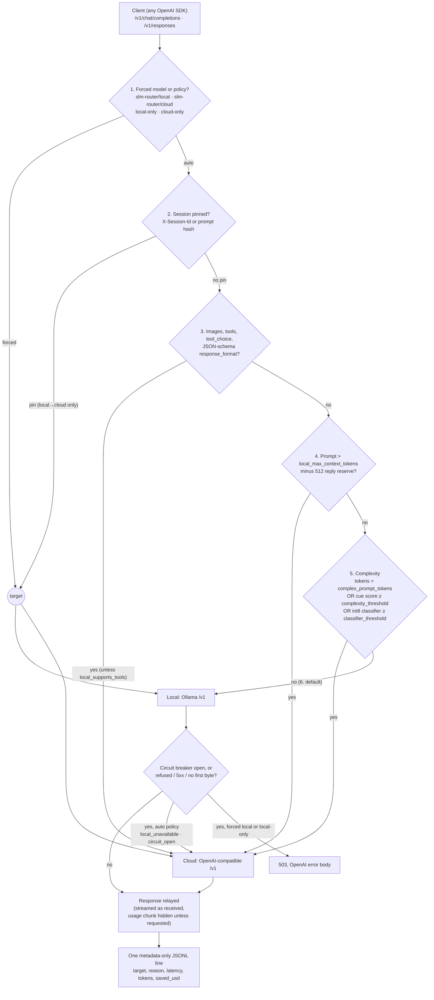

# SLM_Router

A headless, single-binary, OpenAI-compatible proxy that sends each chat request to a local Ollama model or a cloud model, keeps sessions pinned to warm caches, and logs the latency and cloud spend of every decision.

[](https://github.com/yashwardhan-rao/SLM_Router/actions/workflows/ci.yml)
[](https://github.com/yashwardhan-rao/SLM_Router/actions/workflows/release.yml)
[](https://github.com/yashwardhan-rao/SLM_Router/releases/latest)
[](Cargo.toml)

The v1 scope is defined in [SPEC.md](SPEC.md). Development rules are in [CLAUDE.md](CLAUDE.md).

## Problem and why Rust

Developers who run a local model and also pay for a cloud model tend to send everything to the cloud, because switching by hand is tedious. They overpay for trivial requests, send sensitive prompts off-machine, and have no record of what a local model could have saved. Routing per request naively also thrashes the local prompt/KV cache. Existing gateways tend to be heavy: a Python runtime, a UI, a database, or a provider-translation layer.

- **One static binary, no runtime.** `cargo build --release` produces a single ~7.7 MB executable (Linux and Windows builds are attached to each release). No Python environment, database, UI or background service to run alongside it.
- **Routing inside the request path, with no I/O.** `decide()` is a pure function. The Rule 5 classifier is a 64 KB int8 model embedded in the binary and scores a 2 KB prompt in under 50 µs, a budget enforced by a release-mode test.
- **Session pinning keeps caches warm.** A conversation stays on its target, and a pin only ever escalates local to cloud, so a session never falls back to a cold local cache or silently downgrades in quality.
- **No translation layer.** Ollama and the cloud both speak OpenAI-compatible `/v1`, so the body is forwarded as received and unknown fields pass through untouched. The one addition: streamed chat requests ask for `stream_options.include_usage`, so token counts are exact, and the extra usage chunk is hidden from clients that did not ask for it. Clients change only `base_url`.

## Architecture

Every `/v1/chat/completions` and `/v1/responses` request goes through ordered rules; the first match wins.



Notes on the diagram:

- **Policy** is `auto`, `local-only` or `cloud-only`. Clients can tighten it per request with `X-Router-Policy`, never loosen it. A forced model that conflicts with the policy returns 400.
- **Failover** happens only before the first byte reaches the client, so a reply is never spliced from two models. Failovers do not pin. There is no fallback from cloud to local.
- **Circuit breaker:** after `breaker_failures` (2) consecutive unreachable or 5xx replies, local is skipped for `breaker_cooldown_ms` (30 s), then one probe is let through. It is per process and in memory.
- **Stateful `/v1/responses` requests** (`previous_response_id`, `conversation`, `store: true`, `background: true` or an `item_reference` input) always go to cloud, because Ollama ignores those fields. See [`/v1/responses` details](#v1responses-details).

### More than two tiers (v0.6.0)

The diagram shows the legacy `[local]` + `[cloud]` config, which still works and behaves exactly as before. You can also list any number of OpenAI-compatible upstreams as `[[tier]]` entries, cheapest first:

```toml
[[tier]]
name = "small"
base_url = "http://127.0.0.1:11434/v1"
model = "llama3.2:1b"
local = true
max_context_tokens = 4096

[[tier]]
name = "mid"
base_url = "https://api.groq.com/openai/v1"
model = "openai/gpt-oss-120b"
api_key_env = "GROQ_API_KEY"
supports_tools = true
input_per_mtok = 0.15
output_per_mtok = 0.60

[[tier]]
name = "top"
base_url = "https://api.openai.com/v1"
# gpt-6.2-sol is a reasoning model: clients should omit `temperature` and `top_p`, and send tool
# calls through /v1/responses rather than chat completions.
model = "gpt-6.2-sol"
api_key_env = "OPENAI_API_KEY"
# Chat Completions tool calls route to the Groq tier: this needs /v1/responses for tools, rejects temperature/top_p.
supports_tools = false
stateful = true
hard = true
input_per_mtok = 2.00
output_per_mtok = 10.00
```

- Each request goes to the cheapest tier the policy allows that passes the stateful, capability, context and Rule 5 checks. Hard prompts go to the cheapest `hard` tier.
- `local-only` keeps requests on `local = true` tiers. `cloud-only` keeps them off those tiers.
- Pins and failover only move up the ladder. Each tier has its own circuit breaker; set `breaker_failures = 0` to turn it off.
- `slm-router/<name>` forces a tier. The `slm-router/local` and `slm-router/cloud` aliases force the cheapest local or remote tier.
- `saved_usd` is measured against the top tier. The prices above are the providers' listed standard rates on 2026-11-28; check them before relying on the figure.
- Anthropic's OpenAI-compatible endpoint is not a supported tier yet: it rejects common client fields (any `temperature` below 1 on current models, a non-default `top_p`, `n` > 1, `json_object`) and has no `/v1/responses`. The example config explains the details.
- Each log line records the tier that answered in `tier`, and `target` still says `local` or `cloud`.

## Quickstart

**1. Get a binary.** Download `slm-router-linux-x86_64`, `slm-router-windows-x86_64.exe` or `slm-router-macos-aarch64` (Apple silicon) from the [latest release](https://github.com/yashwardhan-rao/SLM_Router/releases/latest), or build from source:

```sh
git clone https://github.com/yashwardhan-rao/SLM_Router.git
cd SLM_Router
cargo build --release          # binary at target/release/slm-router
```

**2. Configure.** Write the example config and set the cloud key. Secrets come from environment variables, never from the file.

```sh
slm-router init                              # writes ./slm-router.toml; refuses to overwrite without --force
                                             # edit [local] and [cloud] models, or use the [[tier]] presets in it
export GROQ_API_KEY=gsk_...                  # the variable named by [cloud] api_key_env
ollama pull llama3.2                         # the example's [local] model
```

**3. Run the proxy.** It binds `127.0.0.1:8080` by default. Binding to any non-loopback address requires `ROUTER_API_KEY`.

```sh
slm-router serve --warmup
```

**4. Send a request.** The `model` field of the reply shows which model answered.

```sh
curl http://127.0.0.1:8080/v1/chat/completions \
  -H "Content-Type: application/json" \
  -H "X-Session-Id: demo-1" \
  -d '{"model": "slm-router/auto", "messages": [{"role": "user", "content": "What is the capital of France?"}]}'
```

With the OpenAI Python SDK, change only `base_url`:

```python
from openai import OpenAI

client = OpenAI(base_url="http://127.0.0.1:8080/v1", api_key="unused-on-loopback")
reply = client.chat.completions.create(
    model="slm-router/auto",   # or slm-router/local, slm-router/cloud; any other name means auto
    messages=[{"role": "user", "content": "Explain how CUDA warp divergence affects kernel throughput."}],
)
print(reply.model, reply.choices[0].message.content)
```

**5. Read the log.**

```sh
slm-router stats --since 24h
```

### Docker and systemd

The [`Dockerfile`](Dockerfile) builds a small Debian image that runs `serve --bind 0.0.0.0:8080`. A non-loopback bind is refused without `ROUTER_API_KEY`, so pass it. Inside a container `127.0.0.1` is the container, so point `[local] base_url` at `http://host.docker.internal:11434/v1` and keep the log on a volume:

```sh
docker build -t slm-router .
docker run --rm -p 8080:8080 -e ROUTER_API_KEY=change-me -e GROQ_API_KEY   --add-host=host.docker.internal:host-gateway   -v "$PWD/slm-router.toml:/etc/slm-router/slm-router.toml:ro" -v slm-router-log:/var/lib/slm-router   slm-router
```

No image is published to a registry. For a Linux host, [`contrib/slm-router.service`](contrib/slm-router.service) is an example systemd unit (dynamic user, secrets from `/etc/slm-router/env`); install steps are in its header.

## Routing Benchmark

`python scripts/eval.py --bench` compares three routers on the 120 labelled prompts in `tests/fixtures/routing_bench.json`. The set has 24 prompts in each of trivia, summarization, coding, debugging and multi-step reasoning, with 12 labelled `local` and 12 `cloud` in each category.

- **Held out.** The prompts were written for this benchmark. The script refuses to run if any prompt overlaps the classifier's training corpus or the `routing_eval.json` prompts used to tune it (word-bigram Jaccard 0.5 or more); the current maximum is 0.38. `routing_eval.json` itself was not reused: its 110-prompt dev split chose the shipped threshold and model variant.
- **The real router.** SLM_Router's column comes from the compiled `--release` binary. `slm-router route` runs the shipped `features()`, `decide()` and classifier with `slm-router.example.toml`, so nothing is reimplemented in Python.

| Router | Routed local | False-local rate | Accuracy | Cost reduction vs always-cloud (raw / misroute-adjusted) | Median routing latency (µs) |
| :--- | ---: | ---: | ---: | ---: | ---: |
| Always cloud | 0.0% | 0.0% | 50.0% | 0.0% / 0.0% | n/a |
| Length cutoff tuned on this dataset (local if <= 118 chars) | 53.3% | 8.3% | 95.0% | 52.9% / 48.7% | n/a |
| Length cutoff tuned on routing_eval.json (local if <= 67 chars) | 29.2% | 0.0% | 79.2% | 28.8% / 28.8% | n/a |
| SLM_Router (rules + classifier) | 63.3% | 26.7% | 86.7% | 63.0% / 49.6% | 28.9 |

- **What the columns mean.**
  - False-local rate is the share of `cloud` prompts kept local.
  - Cost is priced at `gpt-6.2-sol`, $2.00 / $10.00 per million input / output tokens. Input tokens are the router's own estimate, and every request is assumed to produce 300 output tokens.
  - "Misroute-adjusted" charges each wrongly local prompt again at cloud price, as if it were re-asked.
  - Routing latency is the median, over prompts, of the median of 11 runs. A run covers feature extraction, the routing decision and the logged classifier score, on a Ryzen 5 7500X3D.
- **Results.**
  - SLM_Router routes the most traffic locally and makes the largest raw saving. It beats the length heuristic tuned out of sample on accuracy, at 86.7% against 79.2%.
  - The cutoff tuned on this same dataset scores higher, but its threshold was chosen on the test data. It also exploits a length gap in these prompts: 66 characters on average for `local`, 177 for `cloud`.
  - SLM_Router's weakness is short hard prompts with no cue words. Most of its 16 false-local prompts are multi-hop trivia and short logic puzzles, which puts reasoning at 62.5% accuracy and trivia at 79.2%; every other category is at 95.8% or more. Once misroutes are charged back, its saving (49.6%) is close to the in-sample cutoff's (48.7%).
- **Read with care.** 120 prompts is a small sample, and one person wrote and labelled them all. The labels are a judgement of whether a ~1B local model's answer would usually be acceptable, not judged model output. The prompts are single-turn English, and there are no tools, images or long contexts, where rules 3 and 4 would act.

## Benchmarks and evaluation

### Rule 5: keywords (v0.3.0) vs embedded classifier (v0.4.0)

Offline numbers come from `tests/routing_eval.rs` on the labelled prompts in `tests/fixtures/routing_eval.json`, so CI re-checks them on every push.

| | v0.3.0 (keyword cues) | v0.4.0 (cues OR classifier) |
| :--- | :--- | :--- |
| Blind holdout v3, hard prompts caught | 4 / 20 | **16 / 20** |
| Dev split, hard prompts caught | 37 / 53 | **47 / 53** (0.887)\* |
| Easy prompts sent to cloud (false cloud), every split | 0 | **0** |
| Release binary size | 7,607,808 B | 7,690,752 B (**+82,944 B**, ~82.9 KB) |
| Rule 5 scoring cost, 2 KB prompt | keyword match | **< 50 µs**, no I/O |

\* **Post-hoc override.** The dev floor was set at 0.90 before training. The shipped model reached 0.887, and the floor was lowered to 0.88 after seeing the results. That decision was made after the fact and is recorded in the test (`dev_split_meets_floors`).

Holdout v3 was written before any corpus or model existed and is never used to train or tune. Its CI gate requires the classifier to lift recall by at least 0.25 over cues alone. The classifier threshold (0.78) is calibrated on dev only: the lowest value with zero false cloud, plus 0.02.

### Live run: quality improved, savings stayed flat

One `scripts/eval.py` run on the release binary, with `llama3.2:1b` as local and `qwen2.5-coder:7b` on Ollama standing in for the cloud. Classifier-off stands in for v0.3.0 routing.

| | Classifier off | Classifier on |
| :--- | :--- | :--- |
| Correct: dev / holdout / live / convo | 94/110 · 24/40 · 6/6 · 4/4 | 104/110 · 36/40 · 6/6 · 4/4 |
| False cloud | 0 | 0 |
| Hard prompts answered by the 1B model | 32 | 10 |
| `saved_usd`, raw / misroute-adjusted | 0.169 / 0.101 | 0.120 / 0.100 |

Why the dollars did not move: most of the raw saving the keyword router appeared to make came from hard prompts wrongly kept on the 1B model. Once those misroutes are charged back at cloud price, savings are flat (0.101 vs 0.100), and 22 fewer hard prompts get a 1B answer. The gain is quality, not cost. The failover drill is unchanged: from the third request onward, a dead local fails over in about 100 to 160 ms.

### v0.5.0: exact token counts on streams

One live run of the release binary against Ollama 0.40.18 (`llama3.2:1b` local, `qwen2.5-coder:7b` standing in for cloud): 4 requests, 3 of them streamed, all with `tokens_estimated: false`. Before v0.5.0 every streamed chat request was estimated, because neither Ollama nor OpenAI send usage on a stream unless asked. Clients that did not set `include_usage` received no `choices: []` chunk. A CUDA prompt with no cue words went to cloud with `classifier_score` 0.942; "hi" scored 0.339.

### v0.9.0-rc.1: sample `slm-router report`

Smoke test of this release candidate's release-mode binary against Ollama 0.40.18: one auto request ("What is the capital of France?") and one forced to `slm-router/cloud`, with `qwen2.5-coder:7b` on Ollama standing in for the cloud and placeholder prices of $2.50 / $10.00 per million tokens. The excerpt below is `slm-router report --since 1h`; the full output adds reason and tier tables, and `report --json` gives the same numbers as JSON.

| Metric | Value |
| :--- | ---: |
| Requests | 2 (local 1, cloud 1) |
| Routed local | 50.0% |
| Failovers | 0 |
| Tokens kept local | 40 |
| Saved USD | 0.000160 |
| Tokens estimated | 0 of 2 |

| Target | p50 ms | p95 ms |
| :--- | ---: | ---: |
| local (`llama3.2:1b`) | 52 | 52 |
| cloud stand-in (`qwen2.5-coder:7b`) | 4449 | 4449 |

### v1 local benchmark

One run of `python scripts/bench.py --skip-complex` against a release build (`serve --warmup`, auto policy). Numbers are from `slm-router stats` and the request log.

| | |
| :--- | :--- |
| Hardware | Ryzen 5 7500X3D (6 cores / 12 threads), 30.9 GB RAM, Radeon RX 9070 XT, Windows 11 |
| Model | `llama3.2:1b` on Ollama 0.40.18, fully in VRAM |
| Requests | 15: 6 single prompts, a 5-turn session, 4 streamed (2 auto, 2 forced local) |
| Routing | 15 local, 0 cloud, 0 failovers; 6 session-pinned |
| Latency, local | p50 **107 ms**, p95 **1,389 ms** (total time, including generation) |
| Streamed time to first chunk | 13 to 18 ms |
| Ollama cache reuse | session follow-ups: 372 of 420 prompt tokens (89%); single prompts: 138 of 207 (67%, mostly a fixed ~20-token template prefix) |

**Pinned vs unpinned A/B.** Two 5-turn conversations on the same model, one with a fixed `X-Session-Id` and one with a new ID per turn, showed no measurable difference: both stayed fully local, `saved_usd` was $0.012882 vs $0.013017, and follow-up cache reuse was 92% vs 95%. Ollama's cache matches on the prompt prefix, not the session ID, so a pin only pays off when an unpinned conversation would switch targets mid-session, which this run did not exercise.

**Read with care.** All figures are single runs on one machine with a 1B model. This run predates v0.5.0, so its streamed token counts are partly estimated (Ollama sends no usage chunk unless asked) and flagged as such; since v0.5.0 the router asks for usage and stream counts are exact.

## Configuration and CLI

`slm-router init` writes [`slm-router.example.toml`](slm-router.example.toml) to `slm-router.toml`; every option is documented there and unknown keys are rejected at startup. The config is found by `--config`, then `ROUTER_CONFIG`, then `./slm-router.toml`.

| Key | Default | Purpose |
| :--- | :--- | :--- |
| `version` | 1 | Config schema version. Any other value is rejected. |
| `server.bind` | `127.0.0.1:8080` | Listen address. Non-loopback requires `ROUTER_API_KEY`. |
| `server.policy` | `auto` | `auto`, `local-only` or `cloud-only`. |
| `server.max_body_bytes` | 64 MiB | Largest request body. |
| `server.request_stream_usage` | `true` | Ask for exact token usage on streamed chat requests (hidden from clients that did not ask). Turn off if an upstream rejects `stream_options`. |
| `[[tier]]` | none | A cost-ordered ladder replacing `[local]`, `[cloud]` and `[pricing]`; per-tier keys are in [More than two tiers](#more-than-two-tiers-v060) and the example config. |
| `local.base_url`, `local.model` | Ollama `/v1`, `llama3.2` | Local target. |
| `local.first_byte_timeout_ms` | 15000 | Wait before failing over; keep it above a cold model load. |
| `local.breaker_failures`, `local.breaker_cooldown_ms` | 2, 30000 | Circuit breaker. `0` disables it. |
| `cloud.base_url`, `cloud.model`, `cloud.api_key_env` | Groq, `openai/gpt-oss-120b` (in the example config), `GROQ_API_KEY` | Cloud target; the key is read from the named variable. |
| `routing.local_supports_tools` | `false` | Skip Rule 3 for a local model that handles tools and images. |
| `routing.local_max_context_tokens` | 4096 | Match Ollama's loaded context. 512 is reserved for the reply. |
| `routing.complex_prompt_tokens` | 1500 | Rule 5 length trigger. |
| `routing.complexity_threshold` | 2 | Rule 5 keyword-cue score trigger. |
| `routing.cue_min_chars` | 0 | Minimum message length for keyword cues to count. |
| `routing.classifier_threshold` | calibrated (0.78) | Classifier trigger; any value above 1.0 disables it. |
| `routing.reasoning_cues`, `routing.hint_cues` | built-in lists | Override the keyword cues. |
| `pricing.input_per_mtok`, `pricing.output_per_mtok` | unset (example: 0.15, 0.60 for Groq) | Cloud prices for `saved_usd`; without them it is `null`. |
| `session.ttl_secs`, `session.max_pins` | 300, 10000 | Pin idle TTL (match `OLLAMA_KEEP_ALIVE`) and LRU bound. |
| `log.path` | `slm-router.jsonl` | Append-only, metadata-only request log. No rotation. Each line also carries `classifier_score`, the Rule 5 probability (null when the classifier is disabled or the prompt is over `complex_prompt_tokens`), for tuning `classifier_threshold` on real traffic. |

**Commands**

```sh
slm-router serve [--config FILE] [--bind ADDR] [--warmup]   # run the proxy
slm-router stats [--config FILE] [--since 24h]              # counts, % local, tokens kept local, saved USD, p50/p95,
                                                            # routing reasons, errors, client disconnects, estimated tokens
slm-router report [--config FILE] [--since 24h] [--json]    # the same numbers as a Markdown report, or JSON
slm-router calibrate --labels FILE [--config FILE] \
  [--min-local-recall 0.95 | --max-false-local 0.05]         # suggest classifier_threshold from your own labelled prompts
slm-router init [--path slm-router.toml] [--force]          # write the documented example config

python scripts/eval.py --log slm-router.jsonl               # live routing eval against a running router
python scripts/eval.py --log slm-router.jsonl \
  --drill-base http://127.0.0.1:8081/v1 --drill-log dead.jsonl   # also time failover against a router with local down
python scripts/bench.py --skip-complex                      # v1 local latency benchmark
python scripts/eval.py --bench                              # offline routing benchmark (see Routing Benchmark)
slm-router route --prompts FILE [--config FILE]             # routing decision and time per prompt; no upstream call
```

**Calibrating the classifier on your own models.** `calibrate` reads JSONL rows of `{"prompt": "...", "label": "local" | "cloud"}`, where `cloud` means your local model's answer was not good enough. It scores each prompt with the embedded classifier, exactly as the router logs `classifier_score`, and suggests the `classifier_threshold` with the best F1 at catching `cloud` prompts. `--min-local-recall 0.95` instead catches the most cloud prompts while keeping at least 95% of local prompts local, and `--max-false-local 0.05` keeps the most local prompts local while letting at most 5% of cloud prompts stay local. Because the suggestion optimises a target rather than keeping every local prompt local, one noisy or mislabelled prompt cannot push it to an extreme. Before the suggestion it prints a table comparing the suggested threshold, the current one, and the strict keep-every-local-prompt threshold (the rule `scripts/train.py` uses), each with local retention, false-local rate and accuracy on your file:

```
                        threshold  local kept  false local  accuracy
suggested (best F1)         0.699       96.2%         8.2%     94.0%
current                     0.781       98.7%        13.7%     92.7%
strict (keep all)           0.945      100.0%        41.1%     80.1%
```

Paste the value into `[routing]`; the config is never rewritten. Build the file from prompts you actually send, labelling each by whether your local model's answer was good enough. The log cannot supply them: it holds metadata only, never prompt text. Retraining the model itself still uses the Python pipeline below.

**Request headers:** `X-Session-Id` (explicit session for pinning), `X-Router-Policy` (tighten policy for one request), `Authorization: Bearer $ROUTER_API_KEY` (when set). The client's `Authorization` header is never forwarded upstream.

**Endpoints:** `POST /v1/chat/completions`, `POST /v1/responses` (streaming and non-streaming), `GET /v1/models` (lists `slm-router/auto`, the `slm-router/local` and `slm-router/cloud` aliases that resolve, and every tier name).

### `/v1/responses` details

- The body is forwarded as received; only `model` is rewritten. Routing, pinning, failover and logging work as for chat. Usage comes from `usage.input_tokens` / `output_tokens`, or from the `response.completed` event when streaming.
- Stateful requests always go to cloud. Forced local or `local-only` returns 400 `stateful_requires_cloud`. A `null` or `false` value is not stateful.
- Stateful chains must start on cloud. If the first turn was served locally and a later turn sends its `previous_response_id`, the cloud's own error (usually 404) is relayed unchanged. Once a session reaches cloud, its pin keeps it there.
- An upstream without `/v1/responses` (404 or 405 without an OpenAI error body) yields 501 `responses_unsupported`, which never triggers failover.
- A stream that breaks mid-way ends with an `event: error` frame, code `stream_interrupted`.
- `GET` and `DELETE /v1/responses/{id}` are not proxied.

Full behaviour, including token estimation, the classifier's feature spec and its binary format, is in [SPEC.md](SPEC.md).

## Development and reproducibility

**The fast check.** Runs offline in seconds: tests drive the real axum app against in-process fake upstreams, with no network and no Ollama. CI runs the same steps plus `cargo fmt --check`.

```sh
cargo clippy --all-targets -- -D warnings && cargo test
```

**Release-mode tests.** The < 50 µs classifier latency budget is only compiled with optimisations on:

```sh
cargo test --release
```

**Live cloud tests.** `tests/live_cloud.rs` boots the real binary with local Ollama as tier 1 and a real cloud provider as tier 2. It checks five cases: a local auto request, a forced-cloud request, a cloud stream (intact SSE, usage chunk hidden, exact token counts in the log), tool calling with a round trip, and failover from a dead local port. The tests are `#[ignore]`, so the fast check never runs them. They need `GROQ_API_KEY` or `OPENAI_API_KEY`, and spend a few cents at most:

```sh
cargo test --test live_cloud -- --ignored --test-threads=1 --nocapture
```

**Reproduce the Rule 5 model.** Prompts and judge labels are tracked in `data/`; the scripts are standard-library Python.

```sh
python scripts/train.py      # rewrites assets/rule5.bin and tests/fixtures/classifier_parity.json
cargo test                   # parity fixtures check that Rust and Python featurize and score identically
git diff --stat assets/ tests/fixtures/   # compare with the shipped model
```

Training is seeded L2 logistic regression over hashed word and character n-grams, with sparse weights quantised to int8. Rebuilding the corpus from scratch needs Ollama and a judge model:

```sh
python scripts/judge.py --calibrate                       # check judge agreement with hand labels first
python scripts/corpus.py generate --pairs 750             # easy/hard pairs across 24 domains
python scripts/corpus.py answer                           # llama3.2:1b answers (cache, untracked)
python scripts/corpus.py label --judge-base URL --judge-model M
```

The shipped corpus has 1,808 synthetic prompts generated by `gemini-3.5-flash-lite`. Each is labelled by whether `llama3.2:1b`'s own answer passed the same model acting as judge; the judge agreed with the hand labels on 29 of 30 dev prompts. Generated prompts that overlap any eval fixture prompt (word-bigram Jaccard ≥ 0.5) are dropped.

**Conventions.** Every source file stays under 200 lines. Commits follow Conventional Commits. See [CLAUDE.md](CLAUDE.md).

## Project structure

```
src/
  main.rs, cli.rs        serve, stats, report, calibrate, route and init subcommands
  route.rs               offline routing decisions for benchmarks
  calibrate.rs, init.rs  classifier_threshold from labelled prompts; example config writer
  config/                typed, validated TOML config; [[tier]] ladder and legacy desugar
  schema.rs, errors.rs   request types and OpenAI-style errors
  routing/               pure decide(): tier ladder, policy, rules, complexity cues, classifier
  session/               in-memory pin table with TTL and LRU eviction
  app/                   axum handlers: chat, responses, dispatch (route, fail over, pin, relay), SSE relay, log guard, telemetry
  upstream.rs, circuit.rs  upstream HTTP client and local circuit breaker
  tokens.rs              symbol-density token estimate
  logging.rs, stats/     JSONL log; one summary rendered as stats text, Markdown report or JSON
scripts/                 corpus.py, judge.py, train.py, features.py, eval.py, routing_bench.py, bench.py
assets/rule5.bin         embedded classifier (65,574 bytes)
data/                    rule5_prompts.jsonl, rule5_labels.jsonl
tests/                   integration tests against fake upstreams, eval and parity fixtures
Dockerfile, contrib/     container image and example systemd unit
```

## Roadmap

Completed work is ticked below. The full release history is in [CHANGELOG.md](CHANGELOG.md).

- [x] Pure routing core (`decide()`) with unit tests
- [x] axum gateway: `/v1/chat/completions` (streaming and non-streaming), `/v1/models`
- [x] Session pinning and policy
- [x] Upstream clients, streaming, failover
- [x] JSONL logging and `stats` CLI
- [x] v0.2.0: `/v1/responses` passthrough (streaming, stateful-to-cloud routing)
- [x] v0.3.0: density token estimate, Rule 5 scoring, reply reserve, local circuit breaker
- [x] v0.4.0: embedded Rule 5 classifier trained on judged synthetic prompts
- [x] v0.5.0: exact streaming token counts, `classifier_score` in the log, `stats` by reason and outcome
- [x] v0.6.0: N tiers, `[[tier]]` config, failover and pins up the ladder, `tier` in the log
- [x] v0.9.0-rc.1: `slm-router calibrate`, `init` with `[[tier]]` presets, `report`, config `version`, frozen log and `report --json` schemas, macOS build, Dockerfile, systemd unit
- [ ] v1.0.0: the stable release, once packaging, presets and real cloud endpoints are verified; semver from there on

**Where 1.0 is headed.** One binary. Point your OpenAI SDK at it. It answers easy prompts with your local model, sends hard ones to the cheapest cloud model that can handle them, never lets private prompts leave your machine, and shows how much you saved.

| Version | Theme | Main items |
| :--- | :--- | :--- |
| v0.5.0 | Trustworthy numbers | exact streaming usage (`include_usage`, with the usage chunk stripped when the client did not ask for it), per-reason `stats`, classifier score in the log |
| v0.6.0 | N tiers | any number of OpenAI-compatible targets with price and capabilities; `decide()` picks the cheapest tier predicted to succeed; failover and pins move up the ladder only |
| v0.9.0-rc.1 | Calibrate and adoption | `slm-router calibrate` tunes the classifier threshold on your own labelled prompts (retraining stays in Python; per-tier thresholds deferred past 1.0); `init` with `[[tier]]` presets; `report` (Markdown or `--json`); versioned config and log schemas; macOS build, Dockerfile, example systemd unit |
| v1.0.0 (planned) | Stable | the same surface, once packaging, presets and real cloud endpoints are verified; semver from there on; the planned stable surface is listed in [SPEC.md](SPEC.md#stability-planned-for-100) |

Post-1.0, opt-in only: speculative verification (try a cheap tier, escalate on a weak answer), a multi-turn-aware classifier, a semantic cache.

Not planned at any stage: a UI or dashboard, provider translation, multi-tenant auth and quotas, Prometheus endpoints, built-in log rotation.

## Contributors

| Name | Role / Focus |
| :--- | :--- |
| [@Yashwardhan-rao](https://github.com/Yashwardhan-rao) | Routing core and classifier, gateway, streaming and failover, evaluation, benchmarks and documentation |
