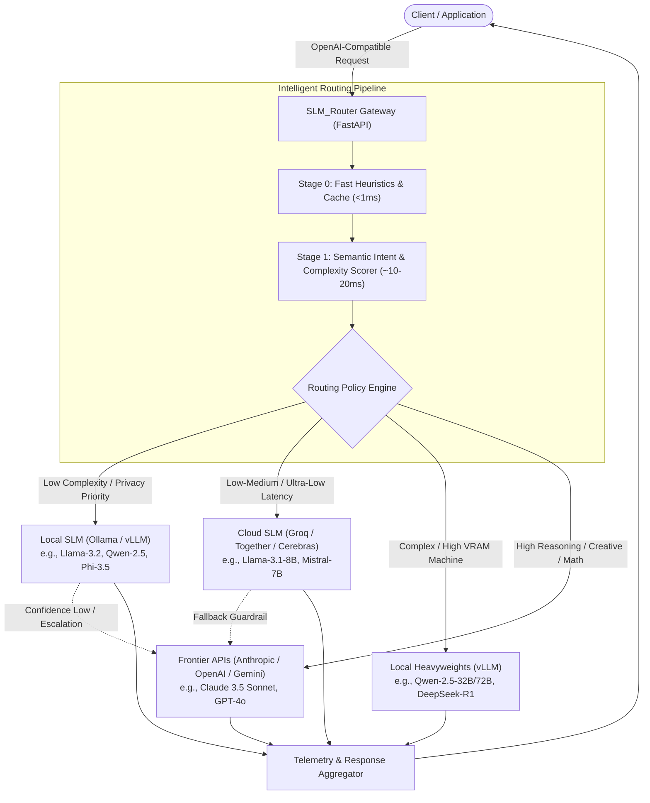

# SLM_Router

> **Intelligent Model Gateway for Cost, Latency, and Privacy Optimization**  
> Dynamically routes user prompts between lightweight Small Language Models (SLMs) and frontier LLMs based on semantic complexity, domain intent, and user-defined cost/privacy budgets.

---

## 1. Executive Summary

Modern AI applications often route 100% of incoming queries to expensive frontier models (e.g., GPT-4o, Claude 3.5 Sonnet). In practice, 65–85% of real-world requests (formatting, extraction, classification, summarization, and direct factual lookups) can be answered with equivalent quality by Small Language Models (SLMs) ranging from 1B to 8B parameters.

**SLM_Router** acts as an intelligent, drop-in reverse proxy (OpenAI-compatible `/v1/chat/completions`) that inspects query complexity and routes each request to the optimal model target, slashing inference costs by up to **80%** and reducing time-to-first-token (TTFT) without sacrificing reasoning quality.

---

## 2. Core Architecture & Routing Strategies

### Multi-Stage Routing Pipeline
An effective routing engine balances classification overhead against token savings. SLM_Router utilizes a multi-tiered pipeline:

1. **Stage 0: Heuristic Pre-filter (< 1ms)**
   - Regex-based intent detection (simple greetings, exact format requests, system prompts).
   - Token length thresholding.
   - Semantic cache hits for repeated queries.

2. **Stage 1: Semantic Complexity Scorer (10–20ms)**
   - Micro-classifier / ONNX embedding evaluation determining:
     - **Complexity Tier**: `Simple` | `Moderate` | `Complex / Reasoning`
     - **Domain Category**: `Code`, `Math`, `Creative Writing`, `Fact Retrieval`, `Extraction`
     - **Task Constraints**: Strict JSON schemas, multi-turn context depth.

3. **Stage 2: Policy & Constraint Dispatcher**
   - Dispatches according to user preferences:
     - **Cost-Optimizer**: Prioritize cheapest capable model (Local SLM -> Cloud SLM -> Frontier).
     - **Latency-First**: Sub-second token delivery (Cloud Groq SLM -> Local SLM -> Frontier).
     - **100% Air-Gapped / Privacy**: Force local-only execution (Ollama / vLLM).
     - **Quality-Preserving**: Only route to SLMs when confidence exceeds a strict safety threshold.

4. **Stage 3: Speculative Verification & Fallback Guardrail**
   - Monitors model output for low perplexity / repetition loops / schema validation failures.
   - Automatically escalates to a frontier model if an SLM underperforms on a critical query.

---

## 3. Supported Model Matrix

| Model Class | Hosting Options | Typical Models | Target Use Cases |
| :--- | :--- | :--- | :--- |
| **Local SLM (1B–8B)** | Ollama, vLLM, llama.cpp | Llama 3.2 (1B/3B), Phi-3.5 (3.8B), Qwen 2.5 (0.5B–7B) | Local inference, offline execution, data extraction, simple Q&A |
| **Cloud SLM (Fast API)** | Groq, Together AI, DeepInfra | Llama 3.1 8B Instant, Mistral 7B, Gemma 2 9B | High throughput, sub-200ms TTFT, bulk summarization |
| **Local Frontier (14B–70B)** | Local vLLM, exllamav2 | Qwen 2.5 32B/72B, DeepSeek-R1-Distill, Llama 3.3 70B | High-end workstation/server private reasoning |
| **Cloud Frontier** | Anthropic, OpenAI, Google | Claude 3.5 Sonnet, GPT-4o, Gemini 2.5 Pro | Deep multi-step reasoning, complex coding, high-stakes decisioning |

---

## 4. Tech Stack

- **API Gateway & Routing Engine**: Python 3.12+, FastAPI, Pydantic v2, Uvicorn, LiteLLM.
- **Classification Engine**: Fast ONNX Runtime / Micro-cross-encoder embeddings.
- **Frontend Dashboard**: React, Vite, TypeScript, `animejs` (motion timelines), `lucide-react`, Tailwind CSS (slate/zinc palette).
- **Monitoring & Metrics**: Token usage tracking, cost savings calculation, latency comparison, model distribution charts.

---

## 5. Project Roadmap

- [x] Initial repository setup & development guidelines ([GEMINI.md](GEMINI.md))
- [x] Package manifests & environment hygiene configuration
- [ ] Comprehensive Product Requirements Document (PRD)
- [ ] FastAPI gateway skeleton with OpenAI-compatible `/v1/chat/completions` endpoint
- [ ] Stage 0 + Stage 1 Routing Scorer implementation
- [ ] Provider integrations (Ollama, Groq, OpenAI, Anthropic via unified interface)
- [ ] React + Anime.js analytics & live routing visualizer dashboard
- [ ] Fallback guardrail & speculative validation layer
