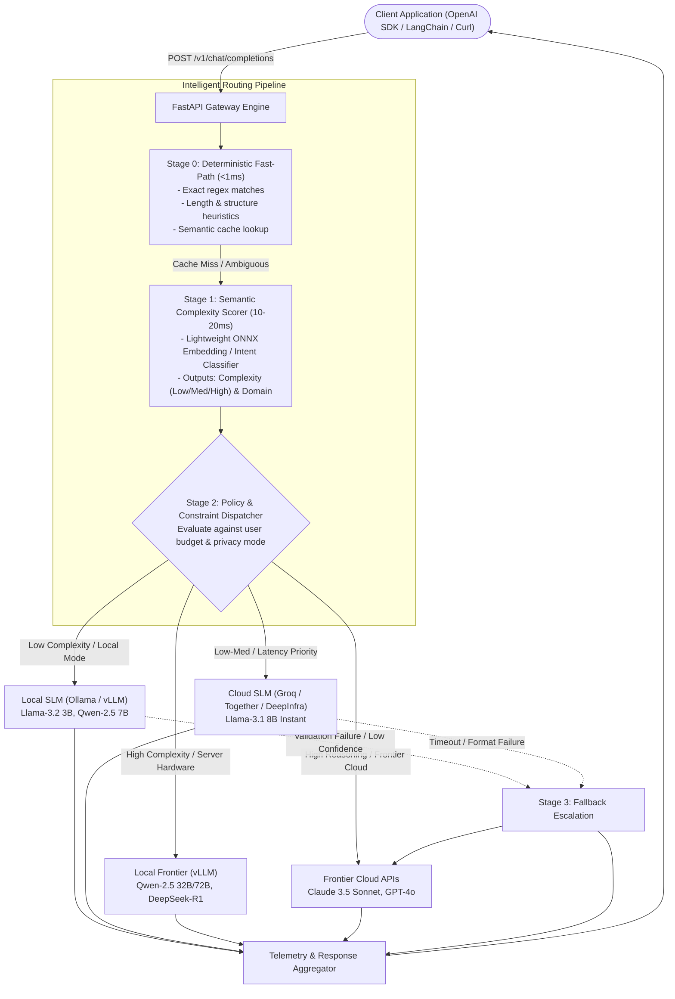
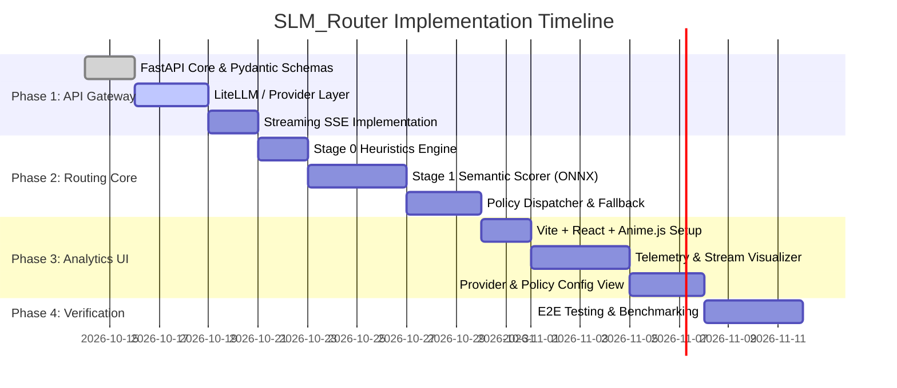

# Product Requirements Document (PRD)

## Project: SLM_Router
**Version:** 1.0.0  
**Status:** Approved  
**Author:** SLM_Router Core Team  
**Last Updated:** October 2026  

---

## 1. Executive Summary & Problem Statement

### 1.1 Context & Problem
Modern AI applications predominantly route 100% of user queries to frontier Large Language Models (LLMs) such as GPT-4o, Claude 3.5 Sonnet, or Gemini 1.5 Pro. These models incur substantial costs ($2.50 to $15.00+ per 1M output tokens) and introduce significant inference latency.

Empirical analysis shows that **65% to 85% of standard user requests** (e.g., classification, structured JSON extraction, summarization, direct factual lookups, boilerplate code generation) can be executed with indistinguishable accuracy by Small Language Models (SLMs) in the 1B to 8B parameter range (e.g., Llama 3.2, Qwen 2.5, Phi-3.5).

### 1.2 Solution
**SLM_Router** is an intelligent reverse-proxy gateway that presents an OpenAI-compatible API (`/v1/chat/completions`) and dynamically evaluates incoming prompt complexity, domain intent, and user constraints. It routes simple and moderate queries to fast, cost-effective SLMs (local or cloud-hosted) while escalating complex, multi-step reasoning tasks to frontier models.

### 1.3 Target Value Metrics
- **Cost Reduction:** Up to 70–80% reduction in aggregate token expenditures across blended workloads.
- **Latency Optimization:** 3x to 5x reduction in Time-to-First-Token (TTFT) for simple queries routed to local hardware or ultra-fast cloud inference engines (e.g., Groq).
- **Zero Client Overhead:** Seamless drop-in replacement requiring only a change of `base_url` in standard OpenAI SDK clients.

---

## 2. System Architecture & Routing Flow



---

## 3. Functional Requirements

### 3.1 Gateway & Proxy Layer
1. **OpenAI Protocol Compliance:**
   - Implement `POST /v1/chat/completions` supporting both standard JSON responses and Server-Sent Events (SSE) streaming (`stream: true`).
   - Implement `GET /v1/models` returning registered local and cloud models.
   - Forward system instructions, tool definitions (`tools`), formatting constraints (`response_format: {"type": "json_object"}`), and temperature/top-p settings transparently.
2. **Authentication & Rate Limiting:**
   - Support optional bearer token validation for incoming client requests.
   - Secure management of downstream provider API keys via environment variables or secret vaults.

### 3.2 Multi-Stage Routing Engine

#### Stage 0: Heuristic Fast-Path (< 1 ms)
- **Deterministic Rules:** Evaluates prompt length (character/token count), regex matching for conversational greetings, basic format conversions, and explicit developer model overrides via header (`x-router-target-model`).
- **Semantic Cache:** In-memory / Redis cache storing hash keys of deterministic queries; returns cached responses instantly when similarity threshold $\ge 0.98$.

#### Stage 1: Semantic Complexity Scorer (10–20 ms)
- **Model:** Lightweight ONNX-runtime cross-encoder or sub-billion embedding model (e.g., `all-MiniLM-L6-v2` or quantized `BGE-small`).
- **Feature Extraction:**
  - Semantic complexity score: `[0.0, 1.0]` mapping to `Simple`, `Moderate`, or `Complex`.
  - Intent classification: `Coding`, `Mathematics / Formal Logic`, `Factual Extraction`, `Summarization`, `Creative Writing`, `Casual Q&A`.
  - Structural constraints: Preserved multi-turn history depth, code-fence frequency, JSON schema presence.

#### Stage 2: Policy & Constraint Dispatcher
- Dispatches each request according to an active policy profile:
  1. **Cost-Optimizer (Default):** Routes `Simple` $\rightarrow$ Local SLM; `Moderate` $\rightarrow$ Cloud SLM; `Complex` $\rightarrow$ Cloud Frontier.
  2. **Latency-First:** Routes `Simple` / `Moderate` $\rightarrow$ Ultra-low-latency Cloud SLM (Groq); `Complex` $\rightarrow$ Frontier.
  3. **Air-Gapped / Privacy:** Disallows any external outbound API calls; routes exclusively between Local SLMs and Local High-VRAM models.
  4. **Quality-Preserving:** High threshold for SLM routing; routes to frontier models whenever confidence score falls below 0.85.

#### Stage 3: Speculative Verification & Fallback Guardrail
- **Detection Triggers:** Repetition loop detection, empty response, unparseable JSON when JSON schema was requested, or downstream provider timeout/5xx errors.
- **Escalation Protocol:** Automatically and transparently retries the query against the designated frontier model, appending telemetry metadata indicating the escalation occurred.

### 3.3 Provider Integration Matrix

| Provider | Integration Type | Default Models | Supported Capabilities |
| :--- | :--- | :--- | :--- |
| **Ollama** | Local REST API (`http://localhost:11434`) | `llama3.2:3b`, `qwen2.5:7b`, `phi3.5:latest` | Chat completions, streaming, offline execution |
| **vLLM** | Local / Network OpenAI-compatible API | `Qwen/Qwen2.5-7B-Instruct`, `Qwen/Qwen2.5-32B-Instruct` | High-concurrency local batched inference |
| **Groq** | Cloud API (Native / LiteLLM) | `llama-3.1-8b-instant`, `mixtral-8x7b-32768` | Sub-200ms TTFT, cloud SLM |
| **OpenAI** | Cloud API | `gpt-4o`, `gpt-4o-mini` | Frontier reasoning, JSON mode |
| **Anthropic** | Cloud API | `claude-3-5-sonnet-20241022`, `claude-3-5-haiku` | Advanced coding & multi-step analysis |

### 3.4 Telemetry & Cost Accounting
- Calculate exact token consumption (prompt tokens, completion tokens, total tokens) per request.
- Calculate **Counterfactual Baseline Cost**: Estimate what the request would have cost if routed directly to GPT-4o or Claude 3.5 Sonnet.
- Record **Net Savings ($)** and **Latency Delta (ms)** per transaction.
- Stream telemetry to in-memory buffers or local SQLite database for dashboard consumption.

### 3.5 Real-Time Analytics Dashboard (UI)
- **Tech Stack:** React 19, Vite, TypeScript, Anime.js motion hooks, Lucide React icons, Vanilla CSS / Tailwind (Slate/Zinc neutral dark palette).
- **Core Views:**
  1. **Live Request Stream:** Real-time log of incoming queries showing prompt preview, detected complexity score, routing decision, and final model provider.
  2. **Cost & Savings Telemetry:** Interactive counters displaying aggregate dollars saved, cost reduction percentage, and total tokens offloaded to SLMs.
  3. **Latency Breakdown:** Comparative charts contrasting SLM TTFT against frontier model latency.
  4. **Policy & Provider Configurator:** Interactive switches to toggle active routing profile (`Cost`, `Latency`, `Privacy`, `Quality`) and inspect local Ollama / cloud API connection status.

---

## 4. Data Contracts & Schema Specifications

### 4.1 Chat Completion Request Payload (Pydantic v2 Schema)

```python
from typing import List, Optional, Union, Dict, Any
from pydantic import BaseModel, Field

class ChatMessage(BaseModel):
    role: str = Field(..., description="Role of the message author (system, user, assistant, tool)")
    content: str = Field(..., description="Contents of the message")
    name: Optional[str] = None

class ChatCompletionRequest(BaseModel):
    model: Optional[str] = Field(default="auto", description="Requested model or 'auto' for intelligent routing")
    messages: List[ChatMessage] = Field(..., description="Chronological conversation context")
    temperature: Optional[float] = Field(default=0.7, ge=0.0, le=2.0)
    top_p: Optional[float] = Field(default=1.0, ge=0.0, le=1.0)
    max_tokens: Optional[int] = Field(default=None, ge=1)
    stream: Optional[bool] = Field(default=False, description="Enable SSE token streaming")
    response_format: Optional[Dict[str, Any]] = None
    tools: Optional[List[Dict[str, Any]]] = None
```

### 4.2 Routing Decision Metadata (Internal Contract)

```python
from enum import Enum
from pydantic import BaseModel

class ComplexityTier(str, Enum):
    SIMPLE = "simple"
    MODERATE = "moderate"
    COMPLEX = "complex"

class DomainIntent(str, Enum):
    CODE = "code"
    MATH = "math"
    EXTRACTION = "extraction"
    SUMMARIZATION = "summarization"
    CREATIVE = "creative"
    GENERAL = "general"

class RoutingDecision(BaseModel):
    complexity_score: float  # 0.0 to 1.0
    tier: ComplexityTier
    intent: DomainIntent
    selected_provider: str   # 'ollama', 'groq', 'openai', 'anthropic'
    selected_model: str      # e.g., 'llama-3.2-3b', 'claude-3-5-sonnet'
    route_reason: str
    stage_trigger: int       # 0 (heuristics), 1 (classifier), or 3 (fallback)
    latency_ms: float
```

### 4.3 Telemetry Record Contract

```python
class TelemetryRecord(BaseModel):
    request_id: str
    timestamp: str
    prompt_tokens: int
    completion_tokens: int
    actual_model: str
    actual_provider: str
    actual_cost_usd: float
    counterfactual_model: str   # e.g., 'gpt-4o'
    counterfactual_cost_usd: float
    savings_usd: float
    time_to_first_token_ms: float
    total_latency_ms: float
    fallback_escalated: bool
```

---

## 5. Non-Functional Requirements

### 5.1 Performance & Latency Budgets
- **Stage 0 Heuristic Evaluation:** $< 1.5\text{ ms}$.
- **Stage 1 Semantic Classification:** $< 25\text{ ms}$ on standard multi-core CPU.
- **Gateway Overhead:** Total internal proxy overhead must not exceed $30\text{ ms}$ (excluding downstream LLM inference time).

### 5.2 Scalability & Concurrency
- Fully asynchronous I/O utilizing FastAPI, AsyncIO, and HTTPX connection pooling.
- Support $\ge 100$ concurrent streaming connections on a standard single-node server.

### 5.3 Reliability & Failure Handling
- **Graceful Provider Fallback:** In the event of downstream API unavailability (e.g., local Ollama daemon down), automatically fallback to configured cloud endpoints without dropping client requests.
- **Error Transparency:** Provide standard HTTP status codes (`400`, `401`, `429`, `502`, `504`) with OpenAI-compatible error payload shapes.

### 5.4 Privacy & Security
- **Data Minimization:** No raw query payloads persisted to permanent disk unless debug logging is explicitly enabled.
- **Air-Gapped Mode:** In `Privacy` mode, all outbound network sockets to external LLM providers are strictly locked down.

---

## 6. Implementation Milestones



---

## 7. Success Criteria & KPIs

1. **Routing Accuracy:** $\ge 92\%$ of simple/extraction tasks correctly routed to SLMs without triggering escalation.
2. **Cost Efficiency:** $\ge 65\%$ net reduction in token costs on mixed benchmark evaluation datasets.
3. **Latency Profile:** $\le 25\text{ ms}$ median routing overhead per query.
4. **Reliability:** $99.9\%$ successful response rate with automatic fallback handling.
