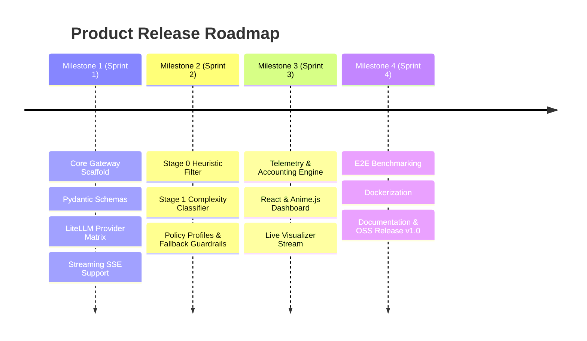

# Product Requirements Document (PRD)

# Project: SLM_Router
**Version:** 1.0.0  
**Status:** Approved / In Development  
**Target Release:** v1.0 MVP  
**Category:** Developer Tooling / AI Infrastructure  

---

## 1. Executive Summary & Problem Definition

### 1.1 The Problem
In modern generative AI systems, developers routinely route 100% of user traffic to high-tier frontier models (e.g., GPT-4o, Claude 3.5 Sonnet, Gemini 1.5 Pro). However, empirical analysis of production workloads demonstrates that **65% to 85% of incoming queries are mechanically simple**:
- Factual extraction and regex-style formatting
- Short-form classification and sentiment tagging
- Text summarization of clear source documents
- Routine conversational banter and simple tool dispatching

Paying frontier prices ($2.50 to $15.00+ per million tokens) for low-complexity queries results in:
1. **Excessive API Expenditures:** Startups and enterprises burn thousands of dollars monthly on tasks capable of being handled by smaller models.
2. **Elevated Latency:** Frontier models exhibit higher Time-to-First-Token (TTFT) and slower generation speeds compared to specialized Small Language Models (SLMs) running locally or on high-speed inference engines (e.g., Groq, Cerebras).
3. **Privacy Vulnerability:** Internal data is unnecessarily sent over the public internet to third-party providers when private, on-premise SLMs could satisfy the prompt.

### 1.2 The Opportunity
The rapid rise of sub-8B models (Llama 3.2 1B/3B, Qwen 2.5 0.5B–7B, Phi-3.5 3.8B) delivers near-frontier accuracy on narrow and moderate tasks at a fraction of the cost ($0.05 to $0.20 per million tokens, or free on local hardware).

### 1.3 The Solution: SLM_Router
**SLM_Router** is an intelligent, drop-in reverse proxy adhering to the standard OpenAI API specification (`/v1/chat/completions`). It inspects query intent and semantic complexity in milliseconds, routing low-complexity requests to lightweight SLMs (local or cloud) while seamlessly reserving expensive frontier models for deep reasoning, mathematics, and complex multi-step coding.

---

## 2. Product Pillars & Value Proposition

| Pillar | Principle | User Value |
| :--- | :--- | :--- |
| **Zero-Friction Adoption** | Strict 100% OpenAI API wire-compatibility. | Developers switch one line of code (`base_url = "http://localhost:8000/v1"`) with zero codebase refactoring. |
| **Aggressive Cost Compression** | Target 60–80% overall token cost savings. | Immediate, measurable reduction in monthly inference expenses without quality degradation. |
| **Predictable Reliability** | Fail-safe routing and automatic escalation. | If an SLM produces invalid output or a provider times out, the router automatically fails over to a frontier model. |
| **Complete Transparency** | Real-time telemetry on latency, dollars saved, and route rationale. | Teams can audit exactly why a model was chosen and verify output quality through an interactive UI. |

---

## 3. Target User Personas & Jobs-to-be-Done (JTBD)

### 3.1 Personas

#### Persona A: Alex — The AI Application Developer / Startup Founder
- **Background:** Building an agentic workflow or customer-facing SaaS application with heavy prompt volume.
- **Core Pain:** Monthly API bills are ballooning into thousands of dollars; rate limits on frontier providers cause downtime.
- **Goal:** Slash inference bills immediately by offloading routine intermediate agent steps to cheap models without breaking code.

#### Persona B: Priya — The Enterprise Security & Compliance Lead
- **Background:** Managing data governance for an internal corporate tool.
- **Core Pain:** Sensitive internal queries cannot be dispatched to external cloud APIs under company compliance policies.
- **Goal:** Enforce local-only execution (Ollama/vLLM) for confidential employee data, with explicit opt-in for external cloud escalation.

#### Persona C: Jordan — The Indie Hacker / Local AI Enthusiast
- **Background:** Running open-source models on consumer hardware (MacBook / RTX GPU) using Ollama.
- **Core Pain:** Manually toggling between local models and OpenAI APIs when prompts get too complex.
- **Goal:** A single endpoint that uses local hardware by default and automatically calls OpenAI only when the query demands high reasoning.

### 3.2 Jobs-to-be-Done (JTBD)
> *"When my application processes high volumes of diverse user prompts, I want an intelligent gateway to evaluate prompt complexity automatically, so that I can minimize costs and latency while preserving full response quality."*

---

## 4. Goals & Non-Goals

### 4.1 Goals (v1.0 In-Scope)
- **Drop-in Wire Compatibility:** Support standard `/v1/chat/completions` (streaming SSE and non-streaming) using existing OpenAI SDKs (Python, TypeScript, cURL).
- **Multi-Stage Tiered Router:**
  - Stage 0: Deterministic heuristic fast-path (< 1.5ms).
  - Stage 1: Semantic complexity classifier (~10–20ms) categorizing prompts into `Simple`, `Moderate`, or `Complex`.
  - Stage 2: Policy-based dispatching across configured providers.
  - Stage 3: Automatic fallback / escalation guardrail.
- **Hybrid Provider Ecosystem:** Out-of-the-box support for:
  - Local SLMs via Ollama / vLLM.
  - Cloud SLMs via Groq / Together AI.
  - Frontier APIs via OpenAI / Anthropic.
- **Configurable Routing Profiles:** Allow users to choose between `Cost-Optimizer`, `Latency-First`, `Air-Gapped / Privacy`, and `Quality-First`.
- **Telemetry & Live Dashboard:**
  - Track prompt/completion tokens, latency, TTFT, and cumulative cost savings.
  - Interactive web interface displaying live request streams and visual route breakdowns.

### 4.2 Non-Goals (v1.0 Out-of-Scope)
- **Model Fine-Tuning / Training:** SLM_Router is an inference gateway; model weights are not trained or updated by the gateway.
- **Multi-Modal / Audio Routing:** v1.0 focuses exclusively on text chat completions. Audio/Vision routing is reserved for v2.0.
- **Multi-Tenant Billing & Metering:** v1.0 is designed for single-team or developer self-hosted deployments, not as a commercial SaaS billing resale platform.

---

## 5. User Stories & Acceptance Criteria

### Story 1: Drop-in Integration
- **As an** application developer,  
- **I want to** point my existing OpenAI client to `http://localhost:8000/v1`,  
- **So that** I do not need to rewrite prompt templates, schemas, or function calling integrations.
- **Acceptance Criteria:**
  - GIVEN an application using `openai.OpenAI(base_url="http://localhost:8000/v1", api_key="sk-dummy")`
  - WHEN it calls `client.chat.completions.create(model="auto", messages=[...])`
  - THEN the gateway returns a standard OpenAI-formatted JSON or SSE stream response with HTTP 200.

### Story 2: Complexity-Based Routing
- **As an** engineer running high-frequency prompts,  
- **I want** simple requests (e.g., "Extract email from text") routed to an SLM and complex tasks (e.g., "Debug this distributed race condition") routed to a frontier model,  
- **So that** simple queries cost pennies and hard queries still receive high-tier reasoning.
- **Acceptance Criteria:**
  - GIVEN a simple extraction prompt
  - WHEN evaluated by the gateway
  - THEN it is classified as `Simple` and dispatched to an SLM (e.g., Llama 3.2 3B).
  - GIVEN a complex multi-step reasoning prompt
  - WHEN evaluated by the gateway
  - THEN it is classified as `Complex` and dispatched to a frontier model (e.g., Claude 3.5 Sonnet / GPT-4o).

### Story 3: Fail-Safe Guardrails & Automatic Escalation
- **As an** application developer,  
- **I want** the router to catch model failures or hallucinations automatically,  
- **So that** low-quality SLM outputs never reach my end users.
- **Acceptance Criteria:**
  - GIVEN an SLM returns an empty string, unparseable JSON (when structured output was requested), or HTTP 500
  - WHEN detected by the Stage 3 guardrail
  - THEN the query is automatically re-executed against the designated frontier model and marked with `fallback_escalated: true` in telemetry.

### Story 4: Live Telemetry & Savings Visibility
- **As a** team lead,  
- **I want** to see real-time metrics showing total dollar savings and routing distribution,  
- **So that** I can prove ROI to leadership and fine-tune routing thresholds.
- **Acceptance Criteria:**
  - GIVEN queries processed by the router
  - WHEN the developer opens the web dashboard
  - THEN the UI displays: cumulative dollars saved vs. frontier baseline, average routing overhead (ms), and percentage of queries routed to SLMs vs. frontier models.

---

## 6. Functional Requirements (FR)

| ID | Feature Name | Description | Priority |
| :--- | :--- | :--- | :--- |
| **FR-1** | **OpenAI API Compatibility** | Support `/v1/chat/completions` (JSON & SSE streaming), `/v1/models`. | **P0** |
| **FR-2** | **Stage 0 Heuristic Scorer** | Regex filters, token length thresholds, and prompt cache lookup in < 1.5ms. | **P0** |
| **FR-3** | **Stage 1 Complexity Classifier** | Fast embedding / cross-encoder model scoring prompt complexity (`0.0`–`1.0`) and domain intent in < 25ms. | **P0** |
| **FR-4** | **Provider Adapters** | Universal adapter supporting Ollama, vLLM, Groq, OpenAI, and Anthropic. | **P0** |
| **FR-5** | **Policy Profiles** | Configurable profiles: `Cost-Optimizer`, `Latency-First`, `Air-Gapped`, `Quality-First`. | **P0** |
| **FR-6** | **Fallback & Escalation** | Auto-retry on frontier model when SLM times out, errors, or fails schema validation. | **P0** |
| **FR-7** | **Cost & Latency Accounting** | Calculate actual cost vs. counterfactual baseline (GPT-4o) and log token counts. | **P1** |
| **FR-8** | **Analytics Dashboard UI** | Web interface displaying real-time stream, cost metrics, and provider status. | **P1** |
| **FR-9** | **Model Override Header** | Allow clients to force a specific model via `model="gpt-4o"` or custom header `X-Router-Model`. | **P1** |
| **FR-10** | **Semantic Cache** | Cache exact/similar prompt responses to deliver sub-5ms cached responses. | **P2** |

---

## 7. Developer & User Experience (DX / UX)

### 7.1 Developer Setup Flow (Target: < 2 Minutes)
1. Start the gateway:
   ```bash
   uvicorn gateway.main:app --port 8000
   ```
2. Update application configuration:
   ```python
   from openai import OpenAI

   client = OpenAI(
       base_url="http://localhost:8000/v1",
       api_key="router-local"
   )

   response = client.chat.completions.create(
       model="auto",  # Enables dynamic routing
       messages=[{"role": "user", "content": "Extract company names from this memo..."}]
   )
   ```

### 7.2 Dashboard User Interface Specifications
- **Design Philosophy:** Dark-mode first using a subtle neutral scale (Zinc/Slate), strict typography scale (`tracking-tight` on headings), no gratuitous gradients or decorative clutter.
- **Key Modules:**
  1. **Header KPI Bar:** Cumulative Dollars Saved, Total Requests Routed, SLM Offload Rate (%), P95 Gateway Latency.
  2. **Live Routing Visualizer:** Real-time stream of incoming queries displaying query snippet, detected complexity badge, routing path, and latency breakdown.
  3. **Policy Switcher:** Instant toggles for active policy profile (`Cost`, `Latency`, `Privacy`, `Quality`).
  4. **Provider Health Matrix:** Status indicators for local Ollama daemon and cloud API keys.

---

## 8. Non-Functional Requirements (NFR)

### 8.1 Performance & Latency Budgets
- **Stage 0 Overhead:** $\le 1.5\text{ ms}$
- **Stage 1 Classification Overhead:** $\le 25\text{ ms}$ on standard multi-core CPU (no dedicated GPU required for routing).
- **Total Gateway Overhead:** $\le 30\text{ ms}$ (exclusive of downstream model generation time).

### 8.2 Reliability & Availability
- **System Uptime:** 99.9% availability for gateway daemon.
- **Failover Guarantee:** No client request dropped due to downstream SLM crash or timeout; transparent failover to frontier model.

### 8.3 Security & Privacy
- **Stateless by Default:** Zero persistence of prompt payloads to disk unless audit logging is explicitly toggled by user.
- **Strict Local Isolation:** In `Air-Gapped / Privacy` mode, network sockets to external cloud APIs are strictly blocked at the transport layer.

---

## 9. Success Metrics & Key Performance Indicators (KPIs)

| Metric | Target | Measurement Method |
| :--- | :--- | :--- |
| **North Star: Cost Reduction %** | **$\ge 65\%$** | $\frac{\text{Baseline Cost} - \text{Actual Cost}}{\text{Baseline Cost}} \times 100$ |
| **SLM Routing Accuracy** | **$\ge 90\%$** | Percentage of SLM routes that complete without triggering fallback escalation |
| **Routing Overhead (P95)** | **$\le 25\text{ ms}$** | Time spent inside routing engine before downstream dispatch |
| **Adoption Friction** | **1 line of code** | Number of code modifications required to integrate existing applications |
| **Fallback Escalation Rate** | **$\le 5\%$** | Percentage of SLM executions that fail over to frontier models |

---

## 10. Release Milestones & Roadmap



---

## 11. Risks & Mitigation Strategies

| Risk | Impact | Probability | Mitigation Strategy |
| :--- | :--- | :--- | :--- |
| **Misclassification (Under-routing)** | Complex query sent to small SLM, resulting in poor answer. | Medium | Provide conservative confidence thresholds; allow client explicit model override (`model="gpt-4o"`); enable Stage 3 guardrail. |
| **Classification Latency Overhead** | Classifier adds too much delay, negating SLM latency benefit. | Low | Use optimized ONNX runtime / quantized micro-encoder running locally on CPU in under 20ms; bypass Stage 1 for cached or short regex queries. |
| **Local Provider Downtime** | Ollama daemon crashes or machine runs out of VRAM. | Medium | Continuous health checks; auto-escalate to cloud SLM (Groq) or frontier API if local socket does not respond within 500ms. |
